<p align="center">
  
</p>

<h1 align="center">ZXraw Explorer</h1>

<p align="center">
  <b>The file explorer for people who shoot.</b><br>
  A fast, free, local-first Windows file manager for photographers and videographers.
</p>

<p align="center">
  <a href="https://github.com/zuhuHix/zxraw-explorer/raw/main/docs/images/hero.jpg"></a>
</p>

> **Status: early development.** Everything below is built, but not all of it is battle-tested
> on real camera files yet. [docs/FEATURES.md](docs/FEATURES.md) lists exactly what is verified
> and how, and [docs/LIMITATIONS.md](docs/LIMITATIONS.md) lists the known gaps.

---

## Why not just use File Explorer?

<p align="center">
  <a href="https://github.com/zuhuHix/zxraw-explorer/raw/main/docs/images/problem.jpg">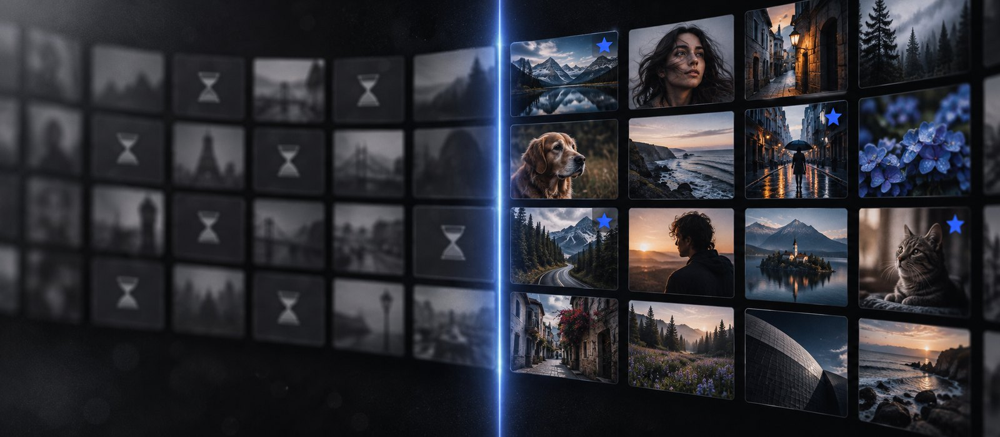</a>
</p>

File Explorer is built to open documents. A shoot is something else: thousands of near-identical
RAW files, a memory card you can't afford to lose, and an evening of picking the keepers. ZXraw
Explorer is a file manager designed around that workflow:

| | File Explorer | ZXraw Explorer |
|---|:---:|:---:|
| RAW thumbnails and previews (CR2, CR3, NEF, ARW, DNG, RAF, ORF…) | needs an extension | ✅ built in |
| Two folders side by side, with tabs | tabs only | ✅ |
| Rate, pick, reject and label photos with single keys | — | ✅ |
| Group bursts and look-alike shots into stacks | — | ✅ |
| Import from a camera card with checksum-verified copies | — | ✅ |
| Batch rename with a live preview and undo | — | ✅ |
| Filters like `ext:cr3 rating:>=4 lens:35mm` | limited | ✅ |
| Duplicate finder, folder compare, folder size analysis | — | ✅ |
| Command palette for every action | — | ✅ |
| Rebind any keyboard shortcut | — | ✅ |
| Collections (manual and smart) that never move your files | — | ✅ |
| Accounts, telemetry, cloud | built in | **none** |

---

## What makes it different

<table>
  <tr>
    <td align="center" width="33%">
      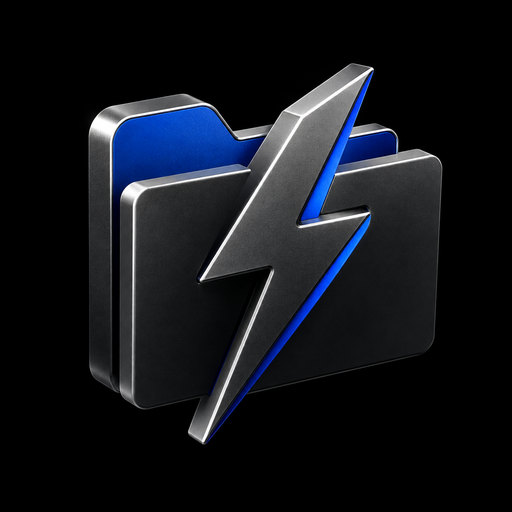<br>
      <b>Fast with huge folders</b><br>
      Folders stream in as they're read and thumbnails are cached on disk, so even a
      50,000-file folder opens without waiting for the whole listing.
    </td>
    <td align="center" width="33%">
      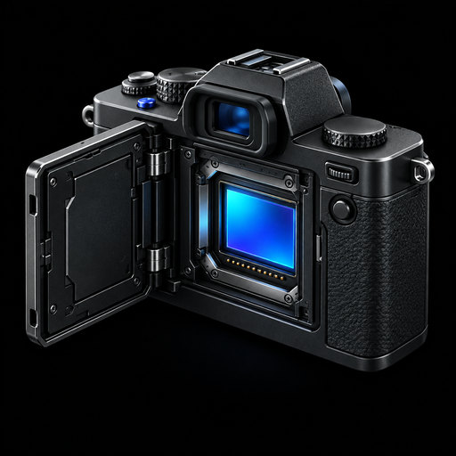<br>
      <b>RAW-native</b><br>
      Thumbnails and previews come straight from the embedded previews in your RAW files.
      No codec packs to install.
    </td>
    <td align="center" width="33%">
      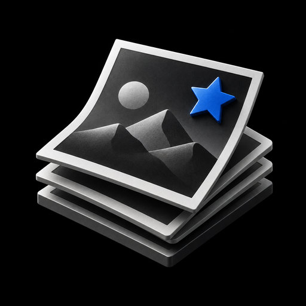<br>
      <b>Built for culling</b><br>
      A full-screen viewer with compare mode, a filmstrip and one-key ratings, picks and
      rejects. Bursts collapse into stacks.
    </td>
  </tr>
  <tr>
    <td align="center">
      <br>
      <b>Careful with your files</b><br>
      Copies are written under a temporary name and only appear when complete. Imports are
      verified with BLAKE3 checksums. Nothing is silently overwritten.
    </td>
    <td align="center">
      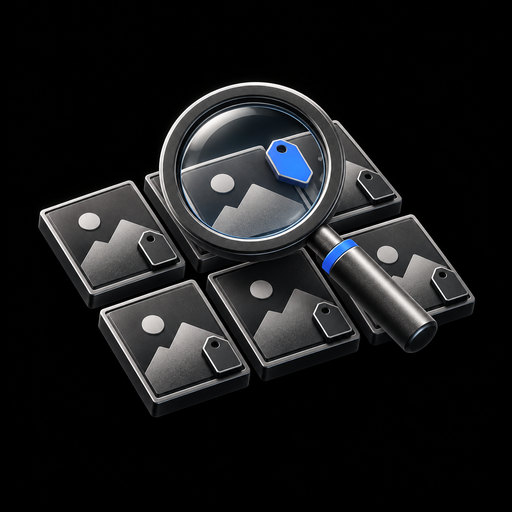<br>
      <b>Find anything</b><br>
      Tags, collections and smart collections, plus search across camera, lens, ISO, rating,
      date and more. Ratings and notes can also be written to XMP sidecars.
    </td>
    <td align="center">
      <br>
      <b>Video too</b><br>
      Clip thumbnails, technical metadata, GoPro chapter grouping and proxy files, using FFmpeg.
      The app can download FFmpeg for you in one click.
    </td>
  </tr>
</table>

---

## See it in action

<p align="center">
  <a href="https://github.com/zuhuHix/zxraw-explorer/raw/main/docs/images/screens/browse.jpg">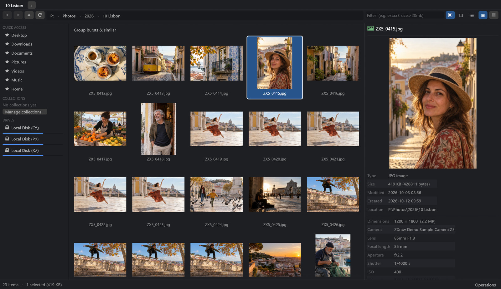</a>
  <br><sub>Thumbnails, a large preview and the camera details for every shot.</sub>
</p>

<table>
  <tr>
    <td width="50%">
      <a href="https://github.com/zuhuHix/zxraw-explorer/raw/main/docs/images/screens/cull.jpg">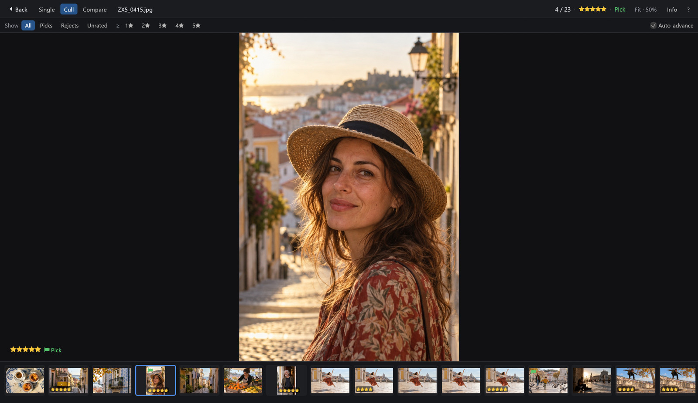</a>
      <b>Cull at full screen.</b> Press <kbd>1</kbd>–<kbd>5</kbd> to rate, <kbd>P</kbd> to pick
      and <kbd>X</kbd> to reject. The next photo comes up automatically, and the filmstrip
      shows what you've already rated.
    </td>
    <td width="50%">
      <a href="https://github.com/zuhuHix/zxraw-explorer/raw/main/docs/images/screens/compare.jpg">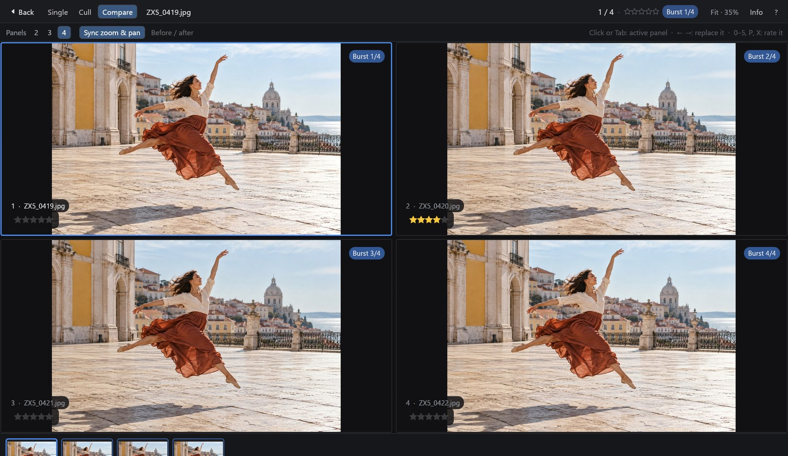</a>
      <b>Compare a burst side by side.</b> Up to four frames, with zoom and pan kept in sync,
      so the sharpest frame is easy to find.
    </td>
  </tr>
  <tr>
    <td>
      <a href="https://github.com/zuhuHix/zxraw-explorer/raw/main/docs/images/screens/bursts.jpg">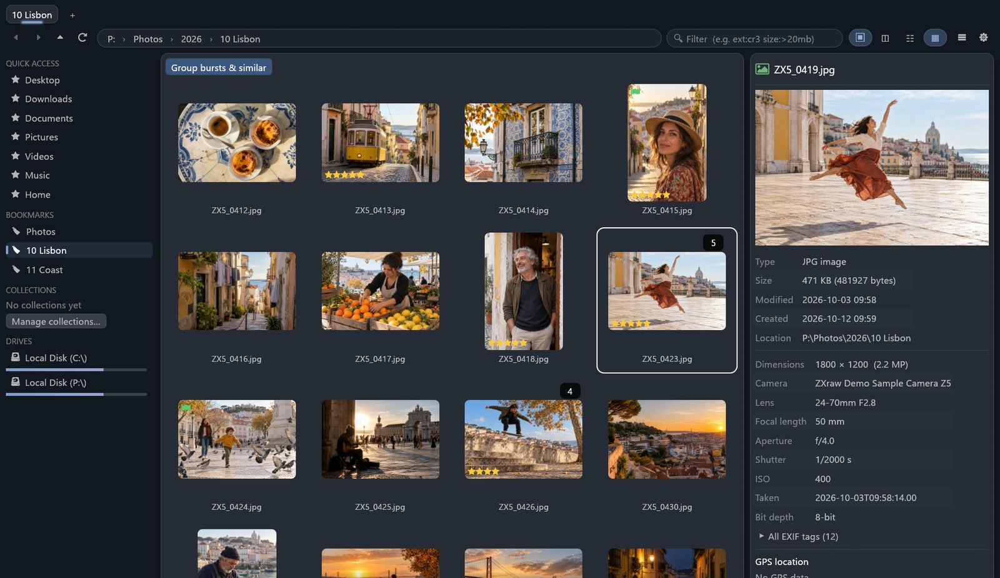</a>
      <b>Bursts collapse into stacks.</b> One click groups burst sequences and look-alike
      shots, so a 23-photo folder reads like the 16 moments you actually shot.
    </td>
    <td>
      <a href="https://github.com/zuhuHix/zxraw-explorer/raw/main/docs/images/screens/dual-pane.jpg">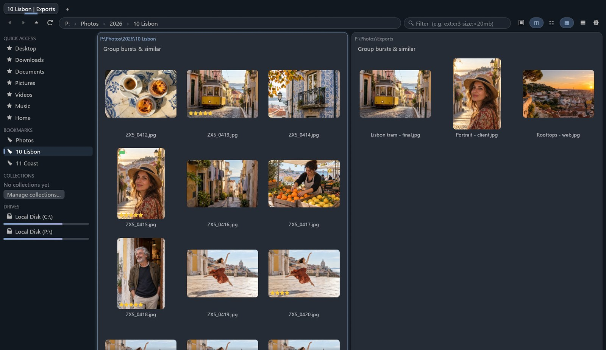</a>
      <b>Two folders side by side.</b> Press <kbd>F3</kbd> to split the view, then
      <kbd>F6</kbd> to copy the selection to the other pane, or <kbd>Shift</kbd>+<kbd>F6</kbd>
      to move it.
    </td>
  </tr>
  <tr>
    <td>
      <a href="https://github.com/zuhuHix/zxraw-explorer/raw/main/docs/images/screens/import.jpg">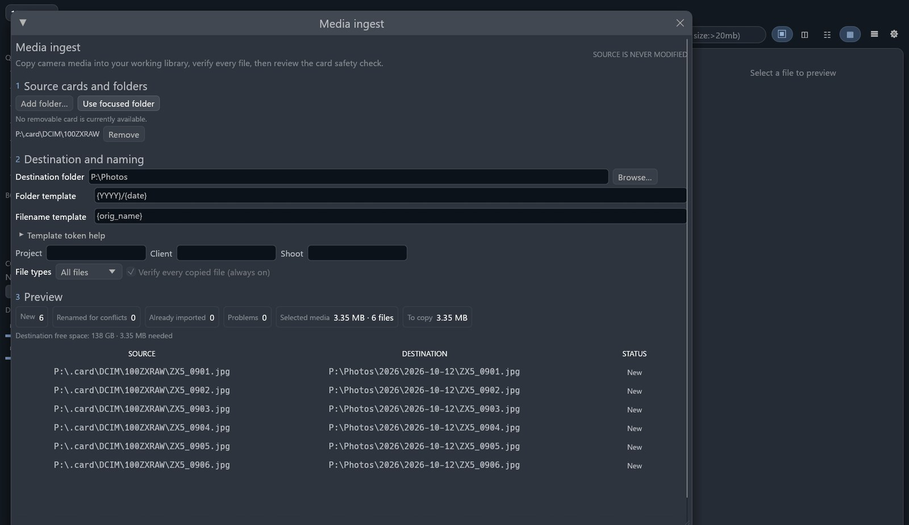</a>
      <b>Plan the import before it copies.</b> The card is mapped into dated
      folders under <code>P:\Photos</code>, every file is verified after copying, and the
      source is never modified.
    </td>
    <td>
      <a href="https://github.com/zuhuHix/zxraw-explorer/raw/main/docs/images/screens/batch-rename.jpg">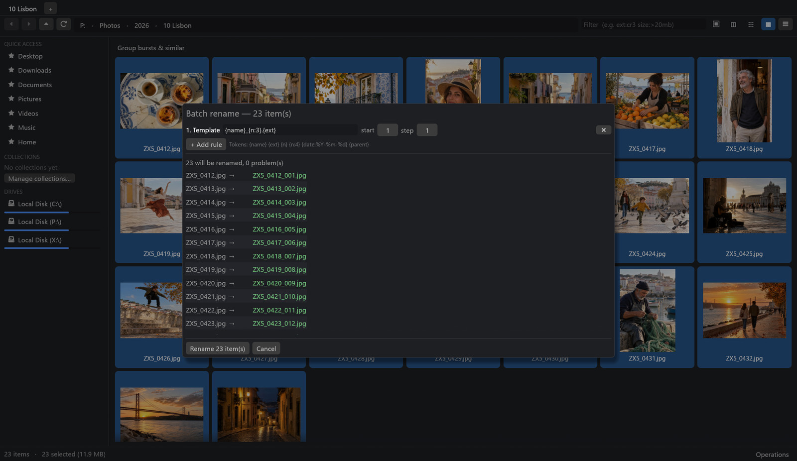</a>
      <b>Batch rename with a live preview.</b> Chain rules and tokens (name, number, date,
      parent folder), see every new name first, and undo afterwards.
    </td>
  </tr>
  <tr>
    <td>
      <a href="https://github.com/zuhuHix/zxraw-explorer/raw/main/docs/images/screens/search.jpg">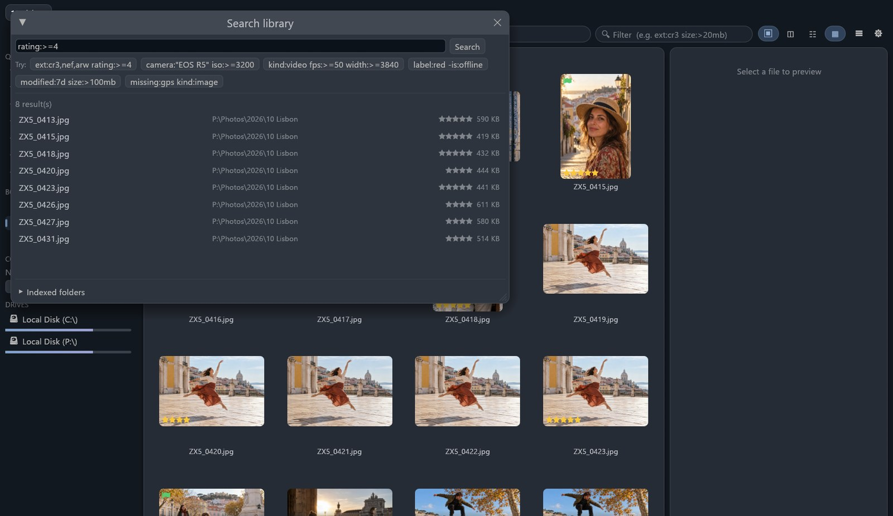</a>
      <b>Search the whole library.</b> Filter by <code>rating:&gt;=4</code>, camera, lens, ISO,
      date, tags and more, across every folder you've indexed.
    </td>
    <td>
      <a href="https://github.com/zuhuHix/zxraw-explorer/raw/main/docs/images/screens/duplicates.jpg">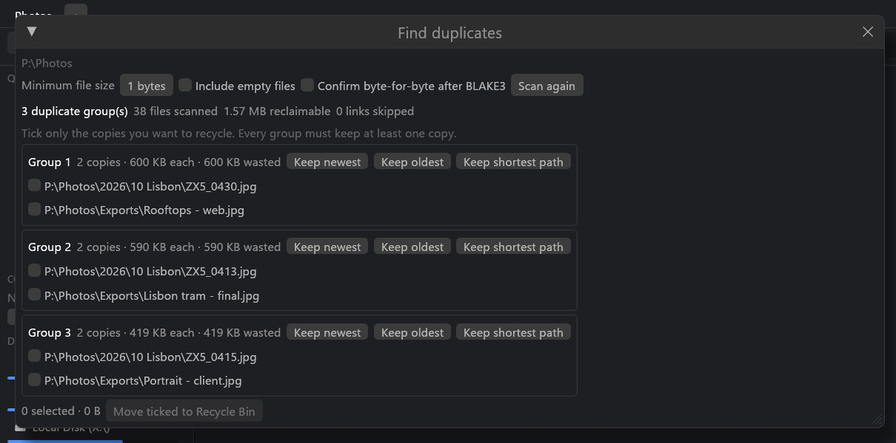</a>
      <b>Find true duplicates.</b> Files are compared by content (BLAKE3), and the app
      re-checks each copy before anything goes to the Recycle Bin.
    </td>
  </tr>
</table>

<p align="center">
  <a href="https://github.com/zuhuHix/zxraw-explorer/raw/main/docs/images/screens/palette.jpg">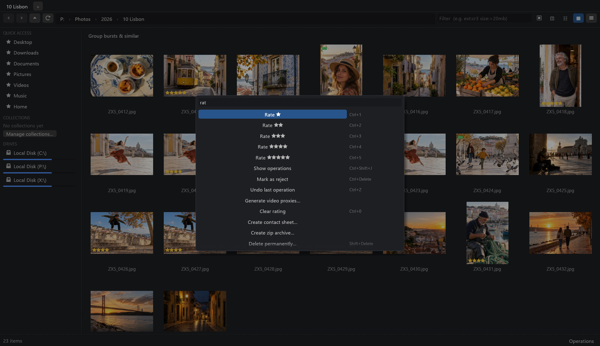</a>
  <br><sub>Every action is in the command palette (<kbd>Ctrl</kbd>+<kbd>Shift</kbd>+<kbd>P</kbd>), with its shortcut.</sub>
</p>

### Make it yours

- **Settings are one click away.** The ⚙ button in the top bar (or <kbd>Ctrl</kbd>+<kbd>,</kbd>) opens them.
- **Your own shortcuts.** Settings › Keyboard shortcuts lists every command. Click *Change*, press
  the keys you want, and it applies immediately. Clashes are flagged, with an offer to move the
  shortcut over. Each command can be reset, or all at once.
- **Collections without the guesswork.** *New collection…* asks what you want (empty, from the
  current selection, or a smart collection that fills itself from a search), explains how
  collections work, and previews what's inside before you open it.
- **Favourites and layouts.** Pin files as well as folders to Quick access (right-click › *Pin to
  Quick access*, or drag them onto the sidebar), and reorder or rename them. *Save layout…* keeps
  your open tabs, split panes, views and sorting, so a culling or delivery workspace is one click
  away from the sidebar's Layouts section.
- **Your NAS in the sidebar.** Save shares like `\\nas\photos` to the Network section, next to
  your mapped drives. A status dot shows which are online, and an offline NAS never freezes the
  window. If a share needs a password, *Connect…* lets Windows ask for it: ZXraw Explorer never
  sees or stores it. Thumbnails, duplicate scans and copies go easier on network folders.
- **Icons that tell files apart.** Code, documents, spreadsheets, programs, archives and config
  files each get their own icon, alongside the photo, video and audio ones.
- **Type to filter.** Settings › Browsing › *Typing in the file list* can switch typing from
  jumping to a name to filtering the list: type a few letters and only matching names stay.
  <kbd>Esc</kbd> clears the filter.
- **Sticky selection.** <kbd>Ctrl</kbd>+<kbd>Shift</kbd>+<kbd>S</kbd> makes every click add or remove
  an item, so picking scattered files needs no <kbd>Ctrl</kbd>. The status bar shows 📌 while it is
  on; <kbd>Esc</kbd> turns it off.
- **Folders that open in place.** In details view, click the arrow beside a folder, or press
  <kbd>→</kbd> / <kbd>←</kbd>, to open it right where it sits. Its contents appear underneath,
  indented, and you can work with them as usual.
- **Pick the look.** Accent colours for the interface, and ten colours for the app icon itself.
- **Notes on any file.** Type a note in the preview panel's *Note* box. It saves on its own a
  moment after you stop typing, and shows whether it is saved. Files with a note get a small ✎
  badge, notes follow files that ZXraw renames or moves, and search finds them (plain text,
  `note:proof`, `has:notes`). With XMP sync on, photo notes are also written to the sidecar as
  `xmpDM:logComment`, so your caption is never touched.
- **Open a terminal here.** Right-click a folder or the empty part of a listing, or press
  <kbd>Ctrl</kbd>+<kbd>Alt</kbd>+<kbd>T</kbd>. It uses Windows Terminal when installed, otherwise
  PowerShell, otherwise cmd; Settings › Browsing picks a specific one. An *as administrator*
  variant is on the folder background menu.
- **Git at a glance.** In a folder inside a Git repository, changed files get a small badge
  (modified, new, conflict), ignored files are dimmed and the status bar shows the branch. On
  by default; turn it off in Settings › Browsing. The status is read in the background by the
  app itself, without running Git or anything a repository's settings name, and without
  following links out of the folder or opening network shares, so browsing a downloaded or
  cloned folder is safe. Huge repositories, submodules, linked worktrees, clones made from a
  local path (hard-linked objects), SUBST drives and network shares show no badges.

<p align="center">
  <a href="https://github.com/zuhuHix/zxraw-explorer/raw/main/docs/images/screens/collections.jpg">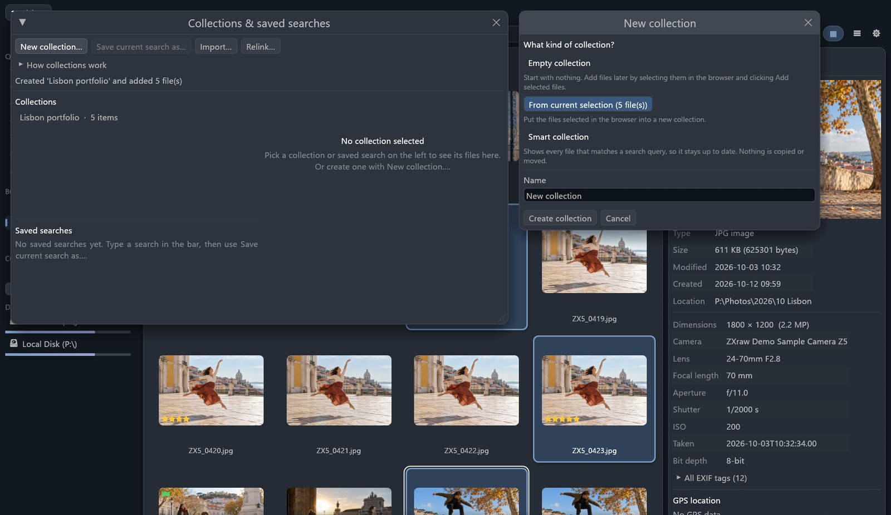</a>
  <br><sub>Collections group files without moving them. Start one from the current selection.</sub>
</p>

<p align="center">
  <a href="https://github.com/zuhuHix/zxraw-explorer/raw/main/docs/images/screens/file-icons.jpg">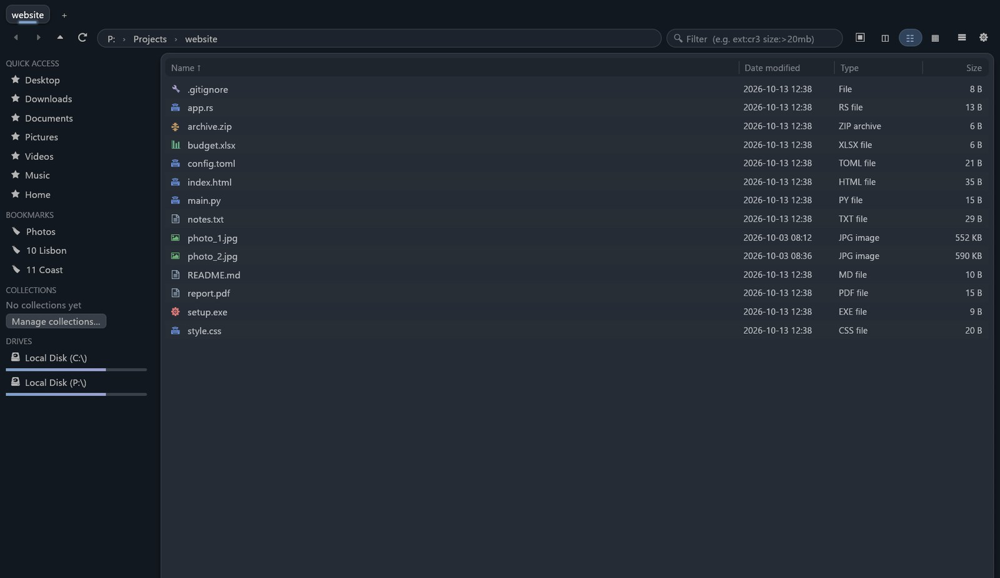</a>
  <br><sub>Code, documents, spreadsheets, programs and archives each get their own icon.</sub>
</p>

<sub>Screenshots are of the real app. The sample photos in them were generated for this page.</sub>

---

### Copying and moving

- **Copies wait their turn.** Copies and moves run one at a time in a queue, so a big transfer
  isn't slowed down by the next one. In the Operations panel you can reorder waiting jobs,
  start one now, cancel it, or pause the whole queue. Transfers between different drives still
  run side by side. Prefer everything at once? Settings › File operations.
- **Works with Explorer's clipboard.** Cut or copy files in Windows Explorer or on the desktop,
  then press <kbd>Ctrl</kbd>+<kbd>V</kbd> in ZXraw Explorer, and the other way round.
- **Cloud files stay in the cloud.** OneDrive, Dropbox and other online-only files are never
  downloaded in the background: thumbnails, checksums, video tools and scans skip them. Before a
  copy that would download many of them, you're told how many files and how much data, and
  can cancel. Copying a big local shoot starts straight away.
- **Renames never overwrite.** If the new name is already taken, you're asked again instead of
  losing a file, even on a slow network drive.

### Batch work on a selection

Every one of these is in the command palette (<kbd>Ctrl</kbd>+<kbd>Shift</kbd>+<kbd>P</kbd>) and can be
given its own shortcut.

- **Export / convert images.** Turn a selection into JPEG, PNG, TIFF or WebP, shrink to a long
  edge or a box (never enlarged), pick the JPEG quality and name the files with a template such
  as `{name}_{n:3}`. RAW files are exported from their embedded preview. Existing files are never
  overwritten.
- **Deliver to client.** <kbd>Ctrl</kbd>+<kbd>Shift</kbd>+<kbd>E</kbd>, or *Deliver to client…* and
  *Deliver with ▸* in the file menu, opens the export with a saved preset such as "Client web
  (2048px JPEG 85, watermark, zip)". Presets hold the format, size, naming, a text or PNG
  watermark (position, size, opacity, with a live preview), "only picks" or "rating ≥ N", and
  whether to write loose files or one `.zip`. By default GPS, serial numbers and other private
  data are stripped while the camera details and copyright are kept. Three presets are built in;
  you can save, duplicate, rename and delete your own.
- **Edit metadata.** Set the title, caption, creator, copyright and keywords on many files at
  once, with a before/after preview. Changes go to XMP sidecars; your originals are not touched.
- **Sync folders.** Compare two folders and preview exactly what will be copied before anything
  happens. *Update* copies newer files one way, *Mirror* makes the right side identical, and
  *Two-way* copies each side's new and newer files to the other without deleting anything.
- **Verify a backup.** Check a backup folder against the original by content (BLAKE3): files
  missing from the backup, copies that differ, files only in the backup and, optionally, files
  that were moved or renamed. A quick mode trusts matching size and date; *Full verify* reads
  every file. Online-only cloud files are reported as not checked instead of being downloaded.
  The report can be saved as CSV or text.
- **Find and replace in files.** Search the folder or the selection for text or a regular
  expression and review every match, old and new side by side, before anything changes. Untick
  the files you want left alone. Binary, RAW, image, video and archive files are never touched,
  the encoding and line endings are kept, and <kbd>Ctrl</kbd>+<kbd>Z</kbd> undoes the replace.
- **Fast name search.** The search window can also ask Everything or the Windows Search index,
  when they are available, instead of the app's own library index.
- **Selection summary.** The status bar shows how many items are selected, their total size and
  the total running time of selected videos and audio.

## Import from a card, safely

<p align="center">
  <a href="https://github.com/zuhuHix/zxraw-explorer/raw/main/docs/images/ingest.jpg">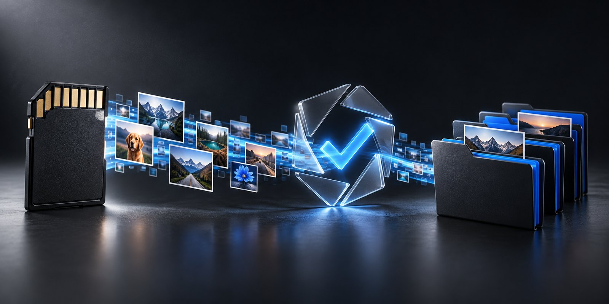</a>
</p>

When you plug in a camera card, ZXraw Explorer offers to import it:

- It plans the copy first, using your own folder template (for example `2026/10-12 Lisbon`), and
  shows exactly what will go where.
- It copies, then **re-reads every file and compares checksums** before calling it done.
- It **never modifies the card.**
- Run the import again and it recognises what's already there, so nothing is duplicated.

## Local and private

<p align="center">
  <a href="https://github.com/zuhuHix/zxraw-explorer/raw/main/docs/images/privacy.jpg">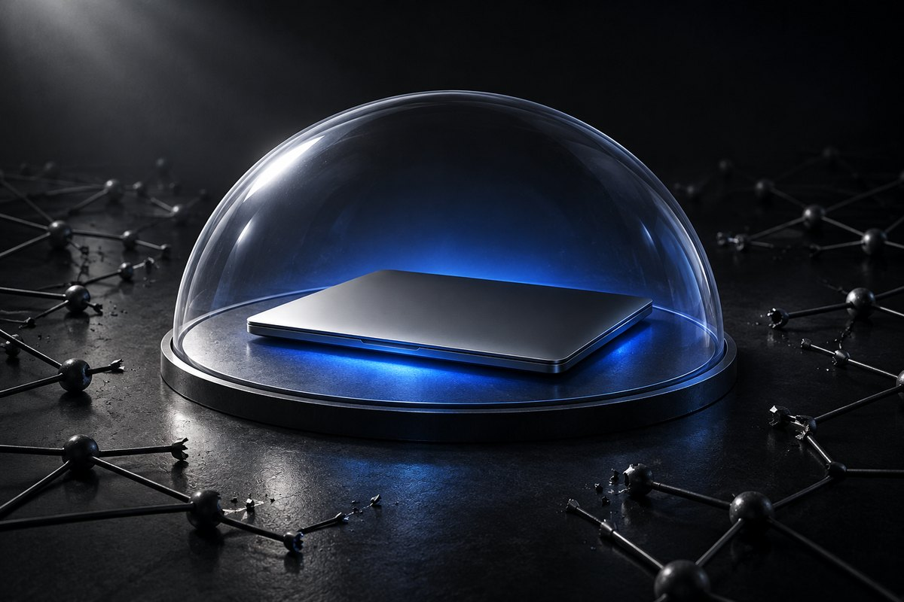</a>
</p>

- No account and no telemetry.
- Your ratings, tags, index and thumbnail cache live in a local database on your PC. Quick access
  pins, saved layouts and saved network locations live in the settings file. Network
  locations you add are read over your own network, as File Explorer would.
- Your files and their contents never leave your PC. The app makes only these network
  connections:
  - **A daily update check.** Once a day it asks `api.github.com` for the latest release of
    ZXraw Explorer. It's a standard web request whose only app-specific detail is the version
    in the User-Agent. It's on by default; turn it off in Settings › Updates.
  - **Updates you click.** *Update now* downloads the installer from this project's GitHub
    releases and runs it only if its SHA-256 matches the release's `SHA256SUMS.txt`.
  - **The optional FFmpeg download.** It only runs when you click it and confirm, and is
    checked against a pinned checksum.

---

## Download

Requirements: Windows 10 or 11 (64-bit).

- **Installer:** `ZXraw-Explorer-<version>-Setup-x64.exe`. Installs for your user only, so no
  admin rights are needed. Optionally adds *Open in ZXraw Explorer* to folder right-click menus.
- **Portable:** `ZXraw-Explorer-<version>-x64.zip`. Unzip anywhere and run `zxraw.exe`.

Builds will be published on the [Releases](../../releases) page. The app isn't code-signed yet,
so Windows SmartScreen may warn the first time: choose *More info → Run anyway*.

---

## Support the project

<p align="center">
  <a href="https://github.com/zuhuHix/zxraw-explorer/raw/main/docs/images/support.jpg">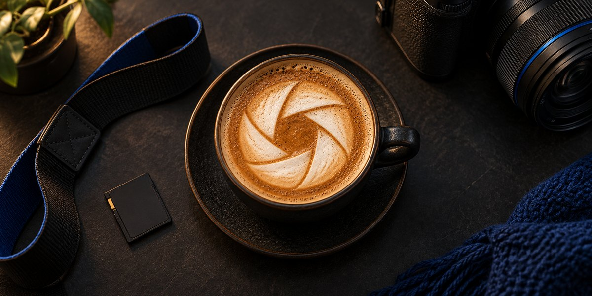</a>
</p>

**ZXraw Explorer is free and will stay free.** No paid tier, no ads, no locked features. If it saves
you time on your next shoot, you can buy me a coffee. Even starring the repo or telling a
photographer friend helps.

<p align="center">
  <a href="https://buymeacoffee.com/zuhu"></a>
</p>

---

## For developers

Requirements: Windows 10/11 x64, Rust ≥ 1.90 (MSVC toolchain).

```powershell
cargo build --release          # target\release\zxraw.exe and zxraw-cli.exe
cargo test --workspace
cargo run -p forge-app         # launch the UI (debug)
packaging\build-release.ps1    # tested release build + portable zip in dist\
```

The installer is built from `packaging\zxraw.iss` with Inno Setup 6.

To cut a release, run `packaging\release.ps1 -Version 1.2.3` (add `-SkipTests` to skip the
test run, `-Draft` for a draft release). It sets the version in `Cargo.toml`, `Cargo.lock`
and `zxraw.iss`, builds the zip and the installer, writes `dist\SHA256SUMS.txt` and prints the
`gh release create` command to publish them. Publish all three files: the in-app updater
refuses an installer that `SHA256SUMS.txt` doesn't list.

Optional: video thumbnails and technical metadata need `ffmpeg.exe` and `ffprobe.exe`.
ZXraw Explorer does not bundle FFmpeg. Use **Download FFmpeg…** (in Settings › Video, the
welcome window or the command palette) to fetch a pinned, checksum-verified build into the
app's data folder. Alternatively, put the tools on `PATH` or choose their folder in Settings.

### Docs

* [Architecture](docs/ARCHITECTURE.md)
* [Plan / TODO](docs/PLAN.md)
* [Feature checklist](docs/FEATURES.md): what's verified, and by which test
* [Testing & benchmarks](docs/TESTING.md)
* [Known limitations](docs/LIMITATIONS.md)
